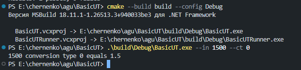
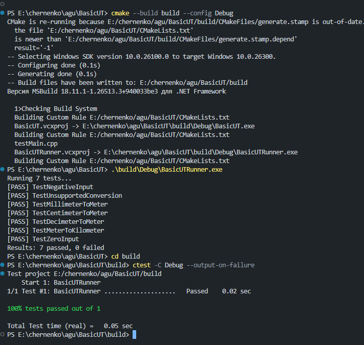

# Отчёт по лабораторной работе №2

**Вариант 4: Обратные преобразования и обработка ошибок**

* **Студент:** Скрипченко Захар Александрович
* **Группа:** 4ИВТ ТИИ
* **Преподаватель:** Черненко А. А.

## 1. Цель работы

Расширить функционал консольного приложения и модуля конвертации единиц длины: добавить обратные преобразования, скорректировать обработку граничных условий (разрешить нулевое значение), добавить обработку исключительных ситуаций (NaN, бесконечность) и написать расширенный набор модульных тестов с интеграцией в CTest.

## 2. Реализация Варианта 4

1. **Обратные преобразования:** в перечисление `EConversionType` добавлены новые типы: `MeterToMillimeter`, `MeterToCentimeter`, `MeterToDecimeter`, `KilometerToMeter`.
2. **Обработка ошибок и граничных условий:**
   * Значение `0` теперь является допустимым (условие проверки изменено на `in < 0`). Текст сообщения об исключении обновлен на `"Input value must be greater than or equal to 0"`.
   * Добавлена проверка входных параметров на NaN и бесконечность (`std::isnan`, `std::isinf`) с выбросом исключения `std::invalid_argument`.
3. **Консольное приложение (`main.cpp`):** обновлена функция подсказки (`PrintUsage`), поддерживающая диапазон аргументов `--ct` от 0 до 7.
4. **Модульные тесты (`testMain.cpp`):** написаны тесты на проверку текста исключения `e.what()`, обработку NaN и бесконечности, а также на проверку обратимости пар преобразований (`Convert(Convert(x, A), B) == x`) для значений 0.0, 1.0, 0.001, 123456.789.

## 3. Демонстрация работы и скриншоты

### Шаг 1. Запуск основного приложения

Проверка работы утилиты с обратным преобразованием (перевод метров в сантиметры, тип `5`):

```bash
.\build\Debug\BasicUT.exe --in 2.5 --ct 5
```



### Шаг 2. Запуск тестового раннера

Результат выполнения расширенного набора тестов (`BasicUTRunner`), включая тесты на обратимость и обработку ошибок:

```bash
.\build\Debug\BasicUTRunner.exe
```



### Шаг 3. Интеграционное тестирование через CTest

Результат проверки утилитой CTest, подтверждающий корректность регистрации и выполнения тестов:

```bash
ctest --test-dir build -C Debug --output-on-failure
```


## 4. Вывод

В ходе выполнения лабораторной работы №2 по Варианту 4 были освоены навыки расширения модульных программ на C++, обработки граничных условий и исключений с проверкой текстов ошибок, тестирования операций с плавающей точкой на обратимость, а также автоматизации сборки и тестирования с помощью CMake и CTest. Все задачи варианта выполнены в полном объёме.