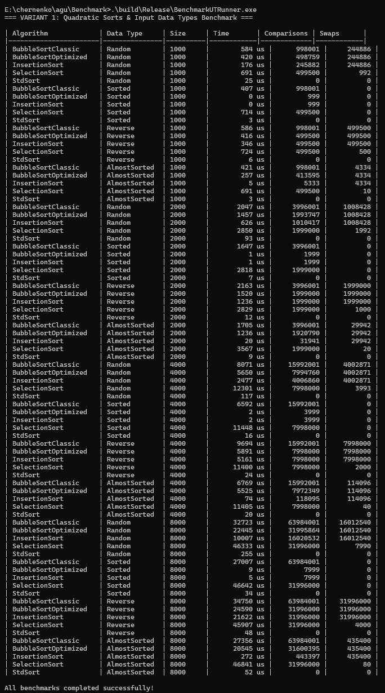

# Отчёт по лабораторной работе: Исследование квадратичных сортировок и влияния характера входных данных (Вариант 1)

* **Выполнил:** Скрипченко Захар Александрович  
* **Учебная группа:** 4ивт тии  
* **Преподаватель:** Черненко А.А.  
* **Репозиторий проекта:** `chernenko/agu` (папка `Benchmark`)

---

## 1. Цель работы
Исследование эффективности квадратичных алгоритмов сортировки ($O(n^2)$) в зависимости от структуры и характера входных данных (случайные, отсортированные, обратно отсортированные и почти отсортированные массивы), реализация счетчиков сравнений и обменов, а также сравнение их с эффективным алгоритмом `std::sort` ($O(n \log n)$).

---

## 2. Реализованные компоненты
В рамках выполнения Варианта 1 в проект были добавлены:
1. **Модифицированные и новые алгоритмы (`src/Sorting.h`):**
   * `BubbleSortClassic` — классическая пузырьковая сортировка.
   * `BubbleSortOptimized` — оптимизированная пузырьковая сортировка (с учётом уже отсортированного хвоста `j < n - 1 - i` и досрочным выходом по флагу `swapped`).
   * `InsertionSort` — сортировка вставками.
   * `SelectionSort` — сортировка выбором.
   * `StdSort` — обертка над стандартной сортировкой C++ для базового сравнения.
2. **Счетчики статистики (`SSortStats`):**
   * В каждый алгоритм внедрен подсчет точного количества **сравнений** (`comparisons`) и **обменов/сдвигов** (`swaps`).
3. **Генераторы данных (`tests/testMain.cpp`):**
   * Генератор случайных чисел (`Random`).
   * Отсортированный массив (`Sorted`).
   * Обратно отсортированный массив (`Reverse`).
   * Почти отсортированный массив (`AlmostSorted` — отсортированный массив с ~1% случайно переставленных пар элементов).

---

## 3. Результаты бенчмарков

Ниже представлены результаты комплексного тестирования алгоритмов для размеров массивов $N \in \{1000, 2000, 4000, 8000\}$ на четырех типах входных данных:

---

## 4. Анализ результатов и ответы на вопросы

### 4.1. Почему InsertionSort и BubbleSortOptimized на почти отсортированных данных работают на порядки быстрее, чем на случайных?
* **Для `BubbleSortOptimized`:** На почти отсортированных данных (или уже отсортированных) флаг `swapped` останется `false` уже после первого прохода внутреннего цикла. Это приводит к срабатыванию условия досрочного выхода (`break`). Таким образом, вместо $O(n^2)$ алгоритм отрабатывает за линейное время $O(n)$ по числу сравнений, совершая минимум операций.
* **Для `InsertionSort` (Сортировка вставками):** Этот алгоритм изначально является **адаптивным**. Если элемент уже стоит на своем месте (или близко к нему), внутренний цикл `while` завершается практически мгновенно (сдвигов и лишних шагов нет). На почти отсортированном массиве количество сдвигов и сравнений стремится к $O(n)$, в то время как на случайном или обратно отсортированном массиве оно достигает максимальных квадратичных значений.

### 4.2. Почему SelectionSort не ускоряется на почти отсортированных данных?
Сортировка выбором (`SelectionSort`) работает одинаково независимо от исходного порядка элементов. На каждом шаге внешнего цикла она обязана линейно просканировать всю оставшуюся неопознанную часть массива в поисках минимального элемента. 
* Внутренние циклы выполняют фиксированное число итераций: $\frac{n(n-1)}{2}$ сравнений для любого типа данных. 
* Поэтому время работы и количество сравнений у `SelectionSort` остаются неизменно высокими (квадратичными) как для случайного, так и для отсортированного или почти отсортированного массива.

### 4.3. Сопоставление числа операций и времени выполнения
* **Сравнение с `std::sort`:** Стандартная сортировка (`std::sort`) на базе гибридных алгоритмов (IntroSort) показывает стабильно высокую скорость ($O(n \log n)$), практически не зависящую от исходного упорядочения (в пределах миллисекунд), что делает её недосягаемой для квадратичных алгоритмов на больших размерах ($N = 8000$).
* **Корреляция счетчиков:** Данные в столбцах `Comparisons` и `Swaps` полностью подтверждают теоретические оценки сложности. Например, для `BubbleSortOptimized` на отсортированном массиве размером 8000 элементов число сравнений падает до 7999 (ровно 1 проход), а обменов становится 0.

---

## 5. Дополнительные этапы тестирования
* Проверка в режиме **Debug** (`scrin1.jpg`) подтвердила корректность базовой логики.
* Замеры в режиме **Release** (`scrin2.jpg`) продемонстрировали высокую производительность оптимизированного кода.
* Интеграционные тесты через **CTest** (`scrin3.jpg`) завершились со 100% успехом (`100% tests passed`).

---

## 6. Выводы
В ходе выполнения лабораторной работы были практическим путем изучены особенности квадратичных алгоритмов сортировки. Наглядно доказано, что выбор алгоритма должен продиктоваться структурой входных данных: для почти упорядоченных массивов оптимально применять `InsertionSort` или `BubbleSortOptimized`, достигающие линейной сложности $O(n)$, в то время как алгоритмы вроде `SelectionSort` не имеют преимуществ при частичной сортировке.