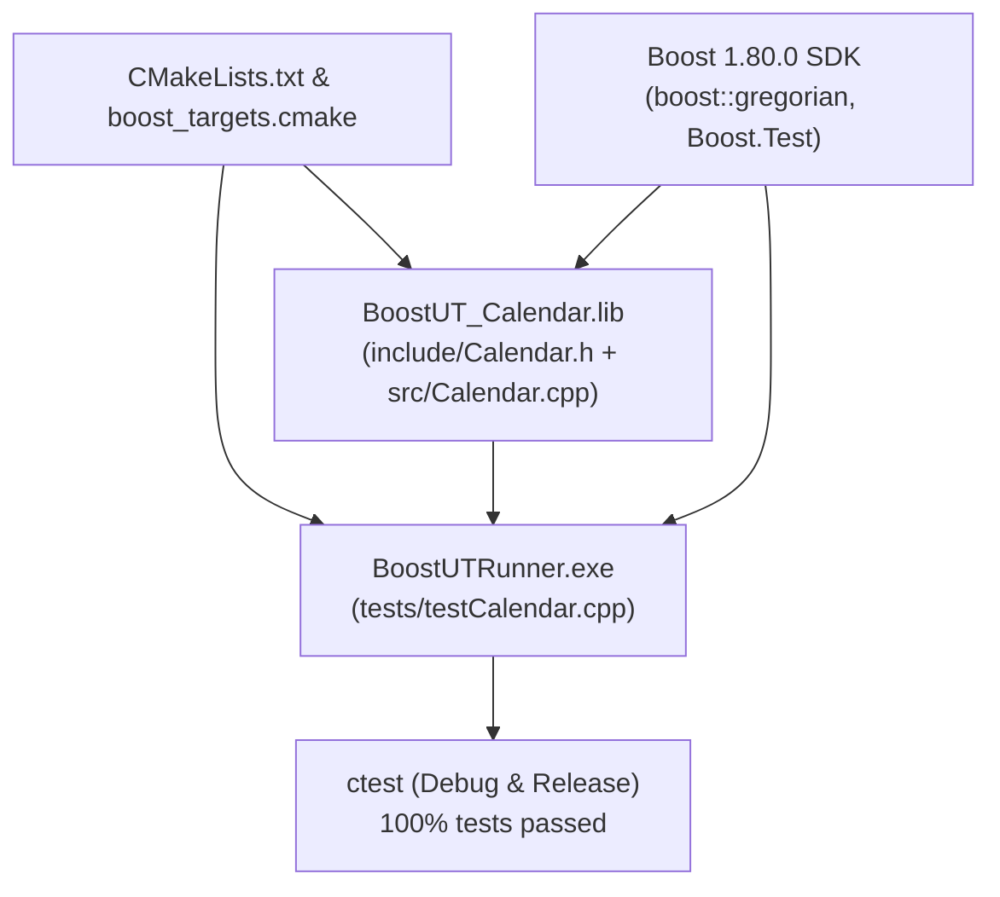

# Отчёт по лабораторной работе №5

**ФИО студента:** Скрипченко Захар

**Номер группы:** 4ИВТ-ТИИ

**Номер работы:** Лабораторная работа №5 (Вариант 1)

**Репозиторий:** `https://github.com/ANIMENDEM/agu` (ветка `main`, каталог `BoostUT`)

## 1. Цель и постановка задачи

Целью лабораторной работы является разработка и интеграция модуля работы с календарными датами и рабочими днями `NCalendar` в проект `BoostUT` с использованием библиотеки **Boost** (SDK 1.80.0, `boost::gregorian`) и системы сборки **CMake / MSVC**, а также покрытие функциональности модульными тестами с применением фреймворка **Boost.Test**.

Основные компоненты и сценарии проверки по варианту №1:

1. Реализация функций календаря и рабочих дней (`IsLeapYear`, `DaysInMonth`, `IsWorkday`, `CountWorkdays`, `AddWorkdays`), включая перегрузки с учётом множества праздников (`HolidaySet`) и обработку некорректных входных данных исключениями (`std::out_of_range`, `std::invalid_argument`).
2. Написание модульных тестов в `Boost.Test`:
   * проверка исключений и граничных интервалов дат;
   * использование фикстуры праздничных дней (`YearHolidaysFixture`);
   * параметризованные датасеты через объединение (`bdata::make(...) ^ bdata::make(...)`);
   * декартово произведение наборов данных (`bdata::make(...) * bdata::xrange(...)`);
   * проверка согласованности `AddWorkdays` и `CountWorkdays` на 100 случайных комбинациях (`bdata::xrange(100) ^ bdata::random(...)`) с учётом того, является ли исходная дата `d` рабочим днём.
3. Сборка проекта в конфигурациях `Debug` и `Release`, запуск тестов через `ctest` и выгрузка результатов в репозиторий GitHub.

## 2. Архитектура проекта и взаимодействие компонентов

Модуль `NCalendar` разделён на заголовочный файл интерфейса, файл реализации и файл модульных тестов, подключаемые через CMake и `boost_targets.cmake` к целевому исполняемому файлу тестов `BoostUTRunner`.



## 3. Описание выполненной работы по заданиям

### 3.1. Реализация интерфейса и логики модуля `NCalendar`

В заголовочном файле `BoostUT/include/Calendar.h` объявлены псевдонимы типов `Date` (`boost::gregorian::date`) и `HolidaySet` (`std::set<Date>`), а также функции пространства имён `NCalendar`:

* `bool IsLeapYear(int year)` — определяет, является ли год високосным;
* `int DaysInMonth(int year, int month)` — возвращает количество дней в месяце с проверкой диапазона `month` в пределах $1..12$ и выбрасыванием `std::out_of_range` при выходе за границы;
* `bool IsWorkday(Date d)` и `bool IsWorkday(Date d, const HolidaySet& holidays)` — проверяют, относится ли дата к рабочим дням (исключая субботу, воскресенье и даты из `holidays`);
* `int CountWorkdays(Date from, Date to)` и перегрузка с `const HolidaySet& holidays` — подсчитывают число рабочих дней на замкнутом интервале $[\text{from}, \text{to}]$; при $\text{from} > \text{to}$ выбрасывают `std::invalid_argument`;
* `Date AddWorkdays(Date from, int days)` и перегрузка с `const HolidaySet& holidays` — смещают дату `from` на заданное число рабочих дней вперёд (`days > 0`), назад (`days < 0`) или возвращают исходную дату при `days = 0`.

```cpp
// Фрагмент проверки границ и подсчёта рабочих дней в BoostUT/src/Calendar.cpp
int DaysInMonth(int year, int month) {
    if (month < 1 || month > 12) {
        throw std::out_of_range("Month must be in range [1, 12]");
    }
    return boost::gregorian::gregorian_calendar::end_of_month_day(year, month);
}

int CountWorkdays(Date from, Date to) {
    if (from > to) {
        throw std::invalid_argument("Start date 'from' must not be later than end date 'to'");
    }

    int count = 0;
    for (Date cur = from; cur <= to; cur += boost::gregorian::days(1)) {
        if (IsWorkday(cur)) {
            ++count;
        }
    }
    return count;
}
```

### 3.2. Разработка модульных тестов и устранение граничного нюанса

В файле `BoostUT/tests/testCalendar.cpp` реализованы тестовые наборы с использованием `BOOST_AUTO_TEST_CASE`, `BOOST_FIXTURE_TEST_CASE` и `BOOST_DATA_TEST_CASE`:

* проверка выбрасываемых исключений (`BOOST_CHECK_THROW`) и вырожденных интервалов (один день, выходной день, прямой и обратный порядок дат);
* проверка работы с праздниками через фикстуру `YearHolidaysFixture`;
* проверка `IsLeapYear` через `bdata::make(...) ^ bdata::make(...)`;
* проверка `DaysInMonth` по годам `2023` и `2024` и всем месяцам $1..12$ через декартово произведение `bdata::make({2023, 2024}) * bdata::xrange(1, 13)`;
* проверка согласованности `AddWorkdays` и `CountWorkdays` на 100 случайных тестах (`bdata::xrange(100)` со случайным смещением даты и числом рабочих дней).

Важный нюанс, выявленный при прогоне случайных тестов: поскольку `CountWorkdays(a, b)` считает рабочие дни **включительно** на обоих концах отрезка, при сдвиге на $n$ рабочих дней от даты $d$ общее число рабочих дней на отрезке зависит от того, является ли сама дата $d$ рабочим днём (`dIsWorkday`):

* при $n > 0$ ожидаемое число рабочих дней на $[d, \text{target}]$ равно $n + (\text{dIsWorkday} ? 1 : 0)$;
* при $n < 0$ ожидаемое число рабочих дней на $[\text{target}, d]$ равно $(-n) + (\text{dIsWorkday} ? 1 : 0)$;
* при $n = 0$ целевая дата равна $d$, а число рабочих дней равно $\text{dIsWorkday} ? 1 : 0$.

```cpp
// Фрагмент проверки согласованности в BoostUT/tests/testCalendar.cpp
const Date d = baseStart + boost::gregorian::days(dayOffset);
const Date target = NCalendar::AddWorkdays(d, n);
const bool dIsWorkday = NCalendar::IsWorkday(d);

if (n > 0) {
    const int expected = n + (dIsWorkday ? 1 : 0);
    BOOST_CHECK_EQUAL(NCalendar::CountWorkdays(d, target), expected);
} else if (n < 0) {
    const int absN = -n;
    const int expected = absN + (dIsWorkday ? 1 : 0);
    BOOST_CHECK_EQUAL(NCalendar::CountWorkdays(target, d), expected);
} else {
    BOOST_CHECK_EQUAL(target, d);
    BOOST_CHECK_EQUAL(NCalendar::CountWorkdays(d, target), dIsWorkday ? 1 : 0);
}
```


### 3.3. Сборка, тестирование и выгрузка в GitHub

Сборка и тестирование выполнялись в Windows (`cmd.exe`, MSBuild / MSVC) для конфигураций `Debug` и `Release`:

```cmd
cmake --build build --config Debug && cmake --build build --config Release && ctest --test-dir build -C Debug --output-on-failure && ctest --test-dir build -C Release --output-on-failure
```


После успешного прохождения тестов в обеих конфигурациях файлы проекта `BoostUT` были добавлены в индекс Git, синхронизированы с удалённой веткой `origin/main` и отправлены на GitHub (коммит `40d63e3`).


| Этап | Конфигурация / Команда | Результат |
| :--- | :--- | :--- |
| Сборка библиотеки и раннера | `Debug` (`BoostUT_Calendar.lib`, `BoostUTRunner.exe`) | Успешно |
| Сборка библиотеки и раннера | `Release` (`BoostUT_Calendar.lib`, `BoostUTRunner.exe`) | Успешно |
| Запуск модульных тестов | `ctest --test-dir build -C Debug` | `100% tests passed` |
| Запуск модульных тестов | `ctest --test-dir build -C Release` | `100% tests passed` |
| Выгрузка в удалённый репозиторий | `git push origin main` (`ANIMENDEM/agu`, `40d63e3`) | Выполнено успешно |

## 4. Выводы

В ходе лабораторной работы №5 (вариант 1) разработан и проверен модуль `NCalendar` с поддержкой расчёта високосных годов, числа дней в месяце, проверки рабочих дней с учётом множества праздников, подсчёта рабочих дней на интервале и смещения даты на заданное число рабочих дней. Написан набор модульных тестов в `Boost.Test` (включая проверку исключений, фикстуру, `zip`, декартово произведение и 100 случайных проверок согласованности), проект успешно собран и протестирован в конфигурациях `Debug` и `Release` (`100% tests passed`), а исходный код и сопутствующие материалы выгружены в репозиторий GitHub.