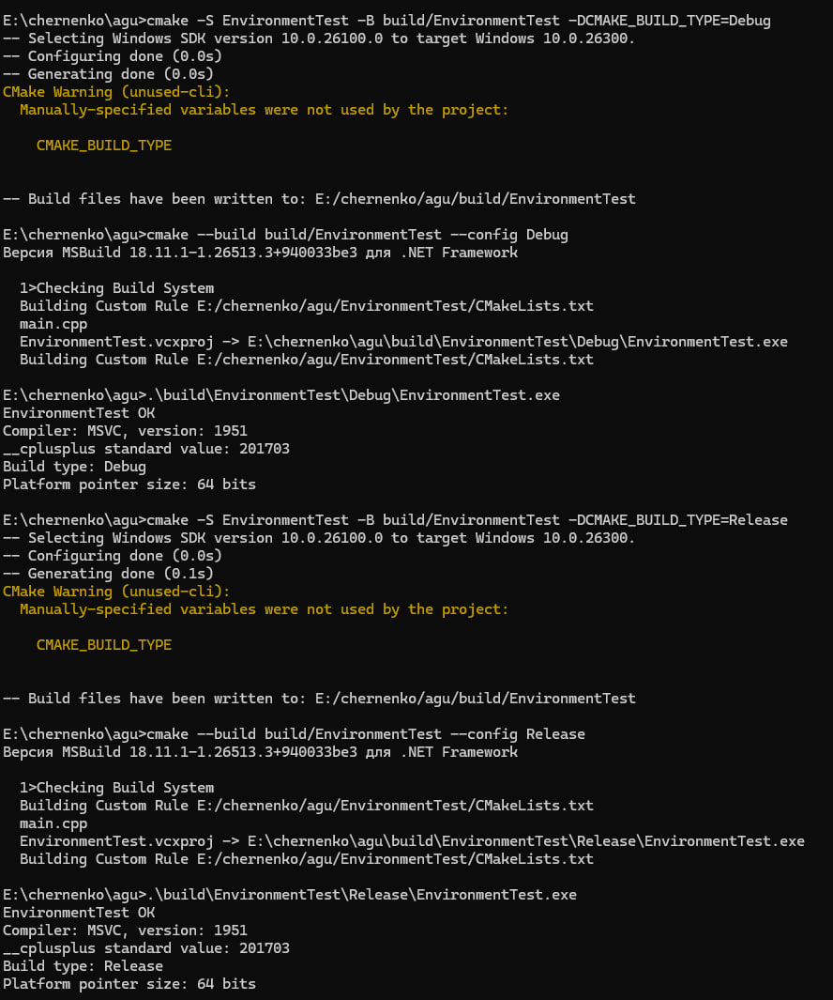
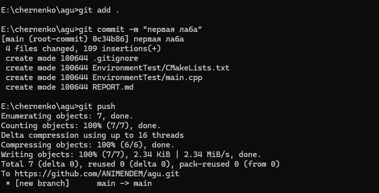

# Отчёт по лабораторной работе №1: EnvironmentTest
**Студент:** Скрипченко Захар Александрович  
**Группа:** 4ИВТ ТИИ  
**Преподаватель:** Черненко А. А.  
**Репозиторий:** [https://github.com/ANIMENDEM/agu.git](https://github.com/ANIMENDEM/agu.git)  

---

### Цель работы
Настройка локального окружения для разработки на C++, освоение системы сборки CMake, конфигурация независимых проектов без общего корневого файла, а также реализация индивидуального задания (Вариант 1: Информация о сборке) с последующей выгрузкой изменений в систему контроля версий Git.

---

### Выполнение заданий

#### 1. Настройка окружения и общая часть
* Создана независимая папка `EnvironmentTest` с личным файлом конфигурации `CMakeLists.txt` и исходным файлом `main.cpp`.
* Настроен файл `.gitignore` для исключения служебной папки `build/` из-под контроля версий.
* Проект успешно сконфигурирован и собран через терминал с помощью команд CMake.

#### 2. Реализация Варианта 1 (Информация о сборке)
В файл `main.cpp` и конфигурацию `CMakeLists.txt` были добавлены макросы для вывода параметров компилятора, стандарта языка, типа сборки и разрядности платформы:
* Задан стандарт C++17 (`CMAKE_CXX_STANDARD 17`) с поддержкой флага `/Zc:__cplusplus` для компилятора MSVC.
* Реализован вывод версии компилятора (`_MSC_VER`), значения макроса `__cplusplus`, типа сборки (`Debug` / `Release` через макрос `NDEBUG`) и разрядности указателей (`sizeof(void*)`).

---

### Результаты выполнения и скриншоты

#### Сборка, запуск и вывод информации в конфигурациях Debug и Release
Ниже приведены результаты сборки проекта из терминала и консольный вывод приложения для обеих конфигураций:

* **Описание вывода:**
  * Программа успешно печатает стандартное приветствие `EnvironmentTest OK`.
  * Выводится текущий компилятор **MSVC** и его версия (`1951`).
  * Корректно отображается значение стандарта C++17 (`__cplusplus standard value: 201703`).
  * Для каждого режима сборки динамически определяется тип: `Build type: Debug` в первом случае и `Build type: Release` во втором.
  * Платформа определена корректно: разрядность указателей составляет `64 bits`.

---

#### Фиксация изменений и отправка в удаленный репозиторий (Git)
Все выполненные компоненты лабораторной работы, включая структуру проекта и отчёт, были зафиксированы в локальном репозитории и отправлены на GitHub:

* **Описание процесса:**
  * Команда `git add .` добавила изменённые файлы в индекс отслеживания.
  * Выполнена фиксация коммита с помощью `git commit -m "первая лаба"`, зафиксировавшая создание ключевых файлов проекта (`.gitignore`, `EnvironmentTest/CMakeLists.txt`, `EnvironmentTest/main.cpp`, `REPORT.md`).
  * Команда `git push` успешно выгрузила ветку `main` в удаленный репозиторий по адресу `https://github.com/ANIMENDEM/agu.git`.

---

### Вывод
В ходе выполнения лабораторной работы было полностью настроено рабочее окружение, освоены базовые команды CMake и принципы изоляции проектных папок. Успешно выполнен Вариант 1 с выводом метаинформации о компиляторе и сборке в режимах Debug и Release. Все этапы работы задокументированы, код проверен и отправлен в личный репозиторий GitHub.