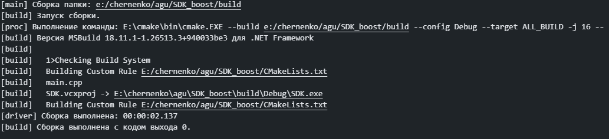
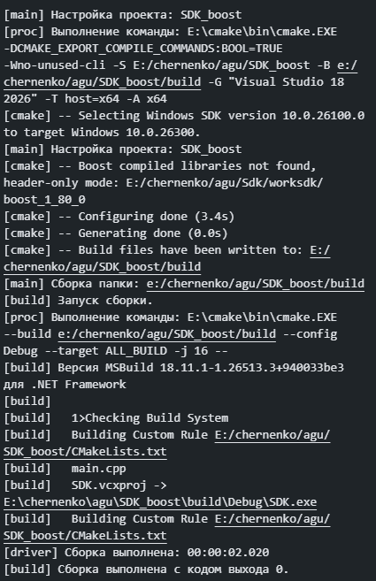

<<<<<<< HEAD
# ОТЧЕТ ПО ЛАБОРАТОРНОЙ РАБОТЕ №4

**«Подключение сторонних библиотек (SDK): Boost»**
**Вариант 1 (Boost.Date_Time)**

**Выполнил:** Скрипченко З.А.
**Проверил:** Черненко А.А.

## 1. Цель работы

Приобретение практических навыков подключения и использования сторонних библиотек (SDK) на примере кроссплатформенной библиотеки **Boost**, в частности модуля **Boost.Date_Time** для работы с датами и временем в языке C++.

## 2. Ход выполнения работы

### 2.1. Выбор и подключение библиотеки

В качестве индивидуального задания был выбран **Вариант 1 (Boost.Date_Time)**. Поскольку данный модуль является *header-only* компонентом библиотеки Boost, интеграция была выполнена напрямую через подключение заголовочных файлов без необходимости сборки бинарных файлов утилит `b2`.

Путь к корневой директории библиотеки Boost в системе:
`E:\chernenko\agu\Sdk\worksdk\boost_1_80_0`

### 2.2. Разработка исходного кода

В корне проекта был создан файл `main.cpp`, использующий компоненты `Boost.Gregorian` (для работы с календарными датами) и `Boost.PosixTime` (для работы с точным временем и временными интервалами).

Ниже представлен листинг разработанной программы:

```
#include <iostream>
#include <boost/date_time/gregorian/gregorian.hpp>
#include <boost/date_time/posix_time/posix_time.hpp>

int main() {
    std::cout << "=== Lab Work: Boost.Date_Time (Variant 1) ===\n\n";

    // 1. Boost.Gregorian (Работа с датами)
    boost::gregorian::date today = boost::gregorian::day_clock::local_day();
    std::cout << "1. Current Date (Gregorian): " << today << std::endl;

    boost::gregorian::date future_date = today + boost::gregorian::days(45);
    std::cout << "   Date in 45 days: " << future_date << std::endl;

    boost::gregorian::date target_date(2026, 12, 31);
    boost::gregorian::days days_left = target_date - today;
    std::cout << "   Days left until the end of 2026: " << days_left.days() << std::endl;

    std::cout << "   Is current year (" << today.year() << ") a leap year? " 
              << (boost::gregorian::gregorian_calendar::is_leap_year(today.year()) ? "Yes" : "No") 
              << "\n\n";

    // 2. Boost.PosixTime (Работа со временем)
    boost::posix_time::ptime now = boost::posix_time::second_clock::local_time();
    std::cout << "2. Current Time (ptime): " << now << std::endl;

    boost::posix_time::time_duration work_shift(3, 15, 0);
    boost::posix_time::ptime shift_end = now + work_shift;
    std::cout << "   Time after shift (+3 hours 15 mins): " << shift_end << std::endl;

    return 0;
}

```


*Скриншот №1: Исходный код программы в среде разработки VS Code.*

### 2.3. Сборка проекта

Для сборки проекта использовалась связка **CMake** и интегрированная среда **VS Code**. Конфигурация автоматически обнаружила header-only библиотеку Boost по указанному пути и успешно сгенерировала файлы проекта MSBuild.


*Скриншот №2: Лог успешной сборки проекта через CMake (код выхода 0).*

## 3. Результаты выполнения

После успешной компиляции был запущен исполняемый файл `build\Debug\SDK.exe`. Программа корректно выполнила все вычисления: определила текущую дату, прибавила 45 дней, рассчитала количество оставшихся дней до конца года, проверила год на високосность, а также вычислила точное время со сдвигом на рабочую смену.


*Скриншот №3: Результат работы программы в терминале.*

## 4. Заключение

В ходе выполнения лабораторной работы были изучены принципы подключения сторонних библиотек на примере **Boost**. На практике освоено применение компонентов `Boost.Gregorian` и `Boost.PosixTime` для решения прикладных задач обработки дат и временных интервалов на языке C++. Цель лабораторной работы полностью достигнута.
=======
# Отчёт по лабораторной работе №1: EnvironmentTest
**Студент:** Скрипченко Захар Александрович  
**Группа:** 4ИВТ ТИИ  
**Преподаватель:** Черненко А. А.  
**Репозиторий:** [https://github.com/ANIMENDEM/agu.git](https://github.com/ANIMENDEM/agu.git)  

---

### Цель работы
Настройка локального окружения для разработки на C++, освоение системы сборки CMake, конфигурация независимых проектов без общего корневого файла, а также реализация индивидуального задания (Вариант 1: Информация о сборке) с последующей выгрузкой изменений в систему контроля версий Git.

---

### Выполнение заданий

#### 1. Настройка окружения и общая часть
* Создана независимая папка `EnvironmentTest` с личным файлом конфигурации `CMakeLists.txt` и исходным файлом `main.cpp`.
* Настроен файл `.gitignore` для исключения служебной папки `build/` из-под контроля версий.
* Проект успешно сконфигурирован и собран через терминал с помощью команд CMake.

#### 2. Реализация Варианта 1 (Информация о сборке)
В файл `main.cpp` и конфигурацию `CMakeLists.txt` были добавлены макросы для вывода параметров компилятора, стандарта языка, типа сборки и разрядности платформы:
* Задан стандарт C++17 (`CMAKE_CXX_STANDARD 17`) с поддержкой флага `/Zc:__cplusplus` для компилятора MSVC.
* Реализован вывод версии компилятора (`_MSC_VER`), значения макроса `__cplusplus`, типа сборки (`Debug` / `Release` через макрос `NDEBUG`) и разрядности указателей (`sizeof(void*)`).

---

### Результаты выполнения и скриншоты

#### Сборка, запуск и вывод информации в конфигурациях Debug и Release
Ниже приведены результаты сборки проекта из терминала и консольный вывод приложения для обеих конфигураций:



* **Описание вывода:**
  * Программа успешно печатает стандартное приветствие `EnvironmentTest OK`.
  * Выводится текущий компилятор **MSVC** и его версия (`1951`).
  * Корректно отображается значение стандарта C++17 (`__cplusplus standard value: 201703`).
  * Для каждого режима сборки динамически определяется тип: `Build type: Debug` в первом случае и `Build type: Release` во втором.
  * Платформа определена корректно: разрядность указателей составляет `64 bits`.

---

#### Фиксация изменений и отправка в удаленный репозиторий (Git)
Все выполненные компоненты лабораторной работы, включая структуру проекта и отчёт, были зафиксированы в локальном репозитории и отправлены на GitHub:



* **Описание процесса:**
  * Команда `git add .` добавила изменённые файлы в индекс отслеживания.
  * Выполнена фиксация коммита с помощью `git commit -m "первая лаба"`, зафиксировавшая создание ключевых файлов проекта (`.gitignore`, `EnvironmentTest/CMakeLists.txt`, `EnvironmentTest/main.cpp`, `REPORT.md`).
  * Команда `git push` успешно выгрузила ветку `main` в удаленный репозиторий по адресу `https://github.com/ANIMENDEM/agu.git`.

---

### Вывод
В ходе выполнения лабораторной работы было полностью настроено рабочее окружение, освоены базовые команды CMake и принципы изоляции проектных папок. Успешно выполнен Вариант 1 с выводом метаинформации о компиляторе и сборке в режимах Debug и Release. Все этапы работы задокументированы, код проверен и отправлен в личный репозиторий GitHub.
>>>>>>> a65be75e1ba24dc0bb3841cf6c15a80ce3c70c70
