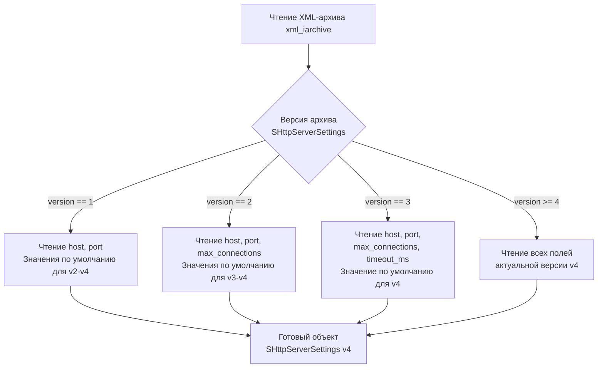

# ОТЧЕТ ПО ЛАБОРАТОРНОЙ РАБОТЕ № 6

**«Сериализация данных и миграция версий структуры `SHttpServerSettings` (`Boost.Serialization`)»**

**Вариант 1**

**Выполнил:** Скрипченко З.А.

**Группа:** 4ИВТ-ТИИ

**Проверил:** Черненко А.А.

**Репозиторий:** <https://github.com/ANIMENDEM/agu.git>

## 1. Цель работы

Освоение механизмов сериализации, десериализации и версионирования объектов в языке C++ на примере библиотеки **Boost.Serialization**, реализация сохранения и загрузки настроек HTTP-сервера `SHttpServerSettings` в XML-формате (`boost::archive::xml_oarchive` / `boost::archive::xml_iarchive`), а также обеспечение обратной совместимости и миграции данных с версий `v1`, `v2` и `v3` на актуальную версию `v4`.

## 2. Ход выполнения работы

### 2.1. Архитектура миграции и подготовка файлов проекта

Для поддержки эволюции структуры `SHttpServerSettings` без потери данных при чтении старых XML-архивов для класса задана актуальная версия `4` с помощью макроса `BOOST_CLASS_VERSION(SHttpServerSettings, 4)` и применено разделение методов записи и чтения через `BOOST_SERIALIZATION_SPLIT_MEMBER()`.



Состав созданных и изменённых файлов в каталоге `Serialization`:

| Файл | Назначение |
| :--- | :--- |
| `Serialization/include/HttpServerSettings.hpp` | Объявление структуры `SHttpServerSettings`, полей конфигурации, оператора сравнения `operator==` для C++17, версии `4`, методов `save` / `load` и функций `SaveToXml` / `LoadFromXml`. |
| `Serialization/src/HttpServerSettings.cpp` | Реализация записи в XML (`xml_oarchive`) и чтения из XML (`xml_iarchive`) с ветвлением по версии архива (`1`, `2`, `3`, `>= 4`). |
| `Serialization/test/main.cpp` | Точка входа тестового раннера `Boost.Test` (`BOOST_TEST_MODULE SerializationTestSuite`). |
| `Serialization/test/HttpServerSettingsTest.cpp` | Модульные тесты `SaveAndLoadXmlRoundTrip`, `MigrateFromV1ToV4`, `MigrateFromV2ToV4` и `MigrateFromV3ToV4`. |
| `Serialization/demo/main.cpp` | Демонстрационное приложение `SerializationDemo` для записи и чтения XML-конфигурации с выводом в консоль. |
| `Serialization/CMakeLists.txt` | Конфигурация сборки целей `SerializationCore`, `SerializationUTRunner` и `SerializationDemo` для `Debug` и `Release`. |

### 2.2. Разработка исходного кода и миграции версий

В заголовочном файле `Serialization/include/HttpServerSettings.hpp` объявлена структура настроек сервера, оператор сравнения для C++17, макрос версии класса и разделённые методы сериализации:

```cpp
struct SHttpServerSettings
{
    std::string host{"0.0.0.0"};
    uint16_t port{8080};
    uint32_t max_connections{100};
    uint32_t timeout_ms{5000};
    bool enable_ssl{false};
    std::vector<std::string> allowed_origins{};

    bool operator==(const SHttpServerSettings& other) const
    {
        return host == other.host &&
               port == other.port &&
               max_connections == other.max_connections &&
               timeout_ms == other.timeout_ms &&
               enable_ssl == other.enable_ssl &&
               allowed_origins == other.allowed_origins;
    }

private:
    friend class boost::serialization::access;

    template <class Archive>
    void save(Archive& ar, const unsigned int version) const;

    template <class Archive>
    void load(Archive& ar, const unsigned int version);

    BOOST_SERIALIZATION_SPLIT_MEMBER()
};

BOOST_CLASS_VERSION(SHttpServerSettings, 4)
```

В файле `Serialization/src/HttpServerSettings.cpp` реализована логика миграции при загрузке архивов разных версий с подстановкой значений по умолчанию для полей, добавленных в более поздних версиях структуры:

```cpp
template <class Archive>
void SHttpServerSettings::load(Archive& ar, const unsigned int version)
{
    if (version == 1)
    {
        ar& BOOST_SERIALIZATION_NVP(host);
        ar& BOOST_SERIALIZATION_NVP(port);
        max_connections = 100;
        timeout_ms = 5000;
        enable_ssl = false;
        allowed_origins.clear();
    }
    else if (version == 2)
    {
        ar& BOOST_SERIALIZATION_NVP(host);
        ar& BOOST_SERIALIZATION_NVP(port);
        ar& BOOST_SERIALIZATION_NVP(max_connections);
        timeout_ms = 5000;
        enable_ssl = false;
        allowed_origins.clear();
    }
    else if (version == 3)
    {
        ar& BOOST_SERIALIZATION_NVP(host);
        ar& BOOST_SERIALIZATION_NVP(port);
        ar& BOOST_SERIALIZATION_NVP(max_connections);
        ar& BOOST_SERIALIZATION_NVP(timeout_ms);
        enable_ssl = false;
        allowed_origins.clear();
    }
    else if (version >= 4)
    {
        ar& BOOST_SERIALIZATION_NVP(host);
        ar& BOOST_SERIALIZATION_NVP(port);
        ar& BOOST_SERIALIZATION_NVP(max_connections);
        ar& BOOST_SERIALIZATION_NVP(timeout_ms);
        ar& BOOST_SERIALIZATION_NVP(enable_ssl);
        ar& BOOST_SERIALIZATION_NVP(allowed_origins);
    }
    else
    {
        throw std::runtime_error("Unsupported SHttpServerSettings archive version");
    }
}
```

### 2.3. Настройка CMake, сборка и тестирование

В `Serialization/CMakeLists.txt` отключена автоматическая линковка (`BOOST_ALL_NO_LIB`) и явно заданы статические библиотеки `boost_serialization`, `boost_wserialization` и `boost_unit_test_framework` из `stage\lib` для конфигураций `Debug` и `Release`:

```cmake
add_compile_definitions(BOOST_ALL_NO_LIB)

set(SER_DBG_LIB "${BOOST_LIB_DIR}/libboost_serialization-vc143-mt-gd-1_80.lib")
set(SER_REL_LIB "${BOOST_LIB_DIR}/libboost_serialization-vc143-mt-1_80.lib")
set(WSER_DBG_LIB "${BOOST_LIB_DIR}/libboost_wserialization-vc143-mt-gd-1_80.lib")
set(WSER_REL_LIB "${BOOST_LIB_DIR}/libboost_wserialization-vc143-mt-1_80.lib")
set(UTF_DBG_LIB "${BOOST_LIB_DIR}/libboost_unit_test_framework-vc145-mt-gd-x64-1_80.lib")
set(UTF_REL_LIB "${BOOST_LIB_DIR}/libboost_unit_test_framework-vc145-mt-x64-1_80.lib")
```


## 3. Результаты выполнения и фиксация в Git

### 3.1. Сборка в Debug и Release, прогон тестов и демонстрация

Проект был собран в конфигурациях `Debug` и `Release`, после чего выполнены модульные тесты через `ctest` и запущено демонстрационное приложение `SerializationDemo.exe`.


### 3.2. Фиксация изменений в удалённом репозитории

Реализованный код, модульные тесты, демонстрационное приложение и скриншоты зафиксированы коммитами и отправлены в ветку `main` репозитория `https://github.com/ANIMENDEM/agu.git`:

| Коммит | Сообщение коммита | Состав изменений |
| :--- | :--- | :--- |
| `3873f94` | `Implement SHttpServerSettings v1->v4 migration and tests` | `CMakeLists.txt`, `include/HttpServerSettings.hpp`, `src/HttpServerSettings.cpp`, `test/main.cpp`, `test/HttpServerSettingsTest.cpp` |
| `e8f2886` | `Add demo and screenshots for Serialization lab` | `demo/main.cpp`, `scrin1.jpg`, `scrin2.jpg` |


## 4. Заключение

В ходе выполнения лабораторной работы № 6 (Вариант 1) освоены механизмы сериализации и версионирования объектов с использованием библиотеки **Boost.Serialization**. Реализована запись и чтение структуры `SHttpServerSettings` в XML-формате и обеспечена миграция со старых версий (`v1`, `v2`, `v3`) на версию `v4` с корректной инициализацией полей по умолчанию. Работоспособность проверена сборкой в режимах `Debug` и `Release`, модульными тестами и демонстрационной программой, а все материалы зафиксированы в ветке `main` репозитория.